# 光匣 · Lightbox

> macOS 摄影集发布台账 —— 解决「拍好的照片忘了发」与「发了小红书却漏了 B 站」。

[](https://github.com/Xlyang18/lightbox)
[](https://www.electronjs.org/)
[](https://react.dev/)
[](TEST-REPORT.md)
[](LICENSE)

光匣不替你上传照片，它替你**记账**。它扫描你的摄影集目录，让你用键盘快速选片、一键标记哪些批次要发到哪个平台，然后把选中的照片打包复制到你的「待发布」文件夹，并在原片文件名尾部追加平台色点标记 —— 一眼就能看出整套片子里哪些发过、哪些还没发。

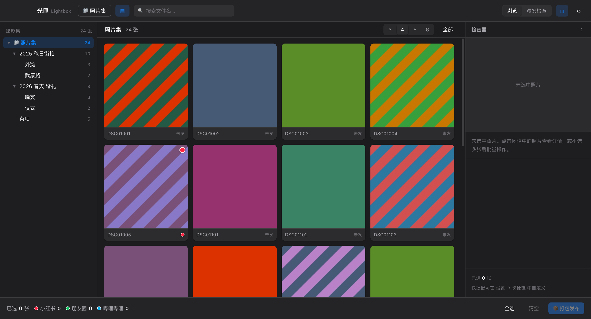

---

## 目录

- [它解决什么问题](#它解决什么问题)
- [核心概念](#核心概念)
- [界面导览](#界面导览)
- [快速上手](#快速上手)
- [功能详解](#功能详解)
- [快捷键](#快捷键)
- [数据与安全](#数据与安全)
- [开发](#开发)
- [测试](#测试)
- [已知限制](#已知限制)

---

## 它解决什么问题

一次拍摄产出几百张照片，修完调色后要分批次发到多个社交平台。这个过程很容易出现两种漏账：

1. **整批忘了发** —— 修完图就放下了，过几天记不起哪些发了。
2. **单平台漏发** —— 小红书发了，朋友圈忘了；或者 B 站发了，小红书忘了。

光匣的处理方式是：把「发布状态」写进**文件名本身**。

```
DSC01234.JPG              ← 一次都没发
DSC01234🔴.JPG            ← 只发了小红书
DSC01234🔴🟢.JPG          ← 小红书 + 朋友圈
DSC01234🔴🟢🔵.JPG        ← 三个平台都发了
```

这样即使脱离光匣，在 Finder 里也能直接看出每张照片的发布状态。

---

## 核心概念

| 概念 | 说明 |
|---|---|
| **摄影集根目录** | 你存放照片的根文件夹，可以有任意多级子目录。光匣递归扫描其中的图片。 |
| **待发布目录** | 打包的目标文件夹。每次打包会在其下新建一个批次子文件夹。 |
| **批次文件夹** | 命名规则 `{打包日}-{平台}-{备注}`，例如 `20261026-小红书-秋日街拍`。 |
| **平台标记** | 文件名尾部的 emoji 圆点，每个平台一个颜色。默认小红书 🔴、朋友圈 🟢、哔哩哔哩 🔵。 |
| **漏发检查** | 一个独立视图，按「从未发布 / 平台不全 / 全平台已发」三分类统计全部照片。 |

### 打包时会发生什么

选中 3 张照片，勾选「小红书 + 朋友圈」，备注填「秋日街拍」，点击确认后：

```
待发布/
├── 20261026-小红书-秋日街拍/     ← 3 张副本
└── 20261026-朋友圈-秋日街拍/     ← 3 张副本

摄影集/2025 秋日街拍/
├── DSC01001🔴🟢.JPG             ← 原片改名（追加标记）
├── DSC01002🔴🟢.JPG
└── DSC01003🔴🟢.JPG
```

原片**只改名，不移动、不删除**。副本沿用改名后的文件名，方便和原片对照。

---

## 界面导览

三栏布局，符合 macOS 原生习惯：

```
┌───────────────────────────────────────────────────────────┐
│ 光匣  [摄影集]  [▤]  搜索…        [浏览│漏发检查] [◫] [⚙] │ 顶栏（毛玻璃）
├──────────┬──────────────────────────────┬─────────────────┤
│ 目录树    │  照片网格（默认 4 列）        │  检查器          │
│ 📁 照片集 │  ┌────┐ ┌────┐ ┌────┐ ┌────┐ │  ┌───────────┐  │
│  ├ 2025  │  │    │ │    │ │    │ │    │ │  │  大图预览  │  │
│  ├ 2026  │  └────┘ └────┘ └────┘ └────┘ │  └───────────┘  │
│  └ 杂项  │  文件名 + 平台色点              │  文件名/尺寸    │
│          │                              │  平台开关       │
├──────────┴──────────────────────────────┴─────────────────┤
│ 已选 3 张 · 小红书 3 · 朋友圈 3 · B站 0      [打包发布(3)] │ 底栏
└───────────────────────────────────────────────────────────┘
```

### 照片卡片

每张卡片包含：

- **缩略图**（后台用系统 API 生成并缓存到 `~/.lightbox/thumbnails`）
- **右上角色点** —— 已发布的平台，颜色对应各平台
- **左上角勾选框** —— 选中时显示
- **悬停快捷按钮** `1 2 3` —— 鼠标移上去才出现，点一下直接打标
- **底部文件名** —— 完整文件名（含标记），一眼确认状态

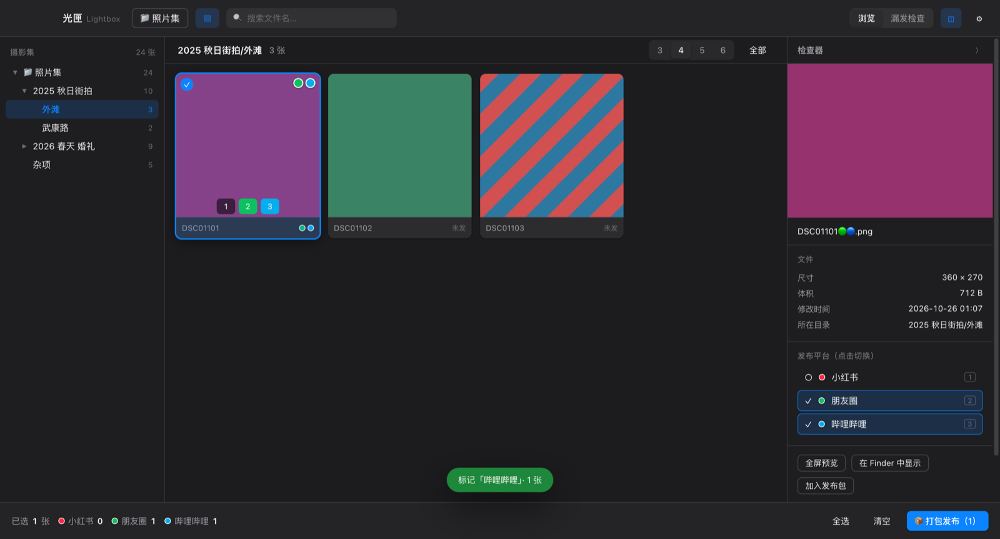

---

## 快速上手

1. 打开 `光匣.app`
2. 点顶栏「📁 打开摄影集」选择照片根目录
3. 打开 **设置 → 通用**，选择「待发布目录」
4. 在左栏点文件夹筛选，在网格里点选照片（支持 `Shift` 连选、拖框多选）
5. 按 `1` `2` `3` 直接给选中的照片打平台标记
6. 或点底栏「📦 打包发布」，勾选平台、填备注、确认
7. 顶栏切到「漏发检查」，随时查看哪些照片还没发齐

---

## 功能详解

### 1. 多级目录浏览

左栏是完整的目录树，每个节点右侧显示该目录（含子目录）的照片总数。点击节点即筛选，根节点代表「全部照片」。

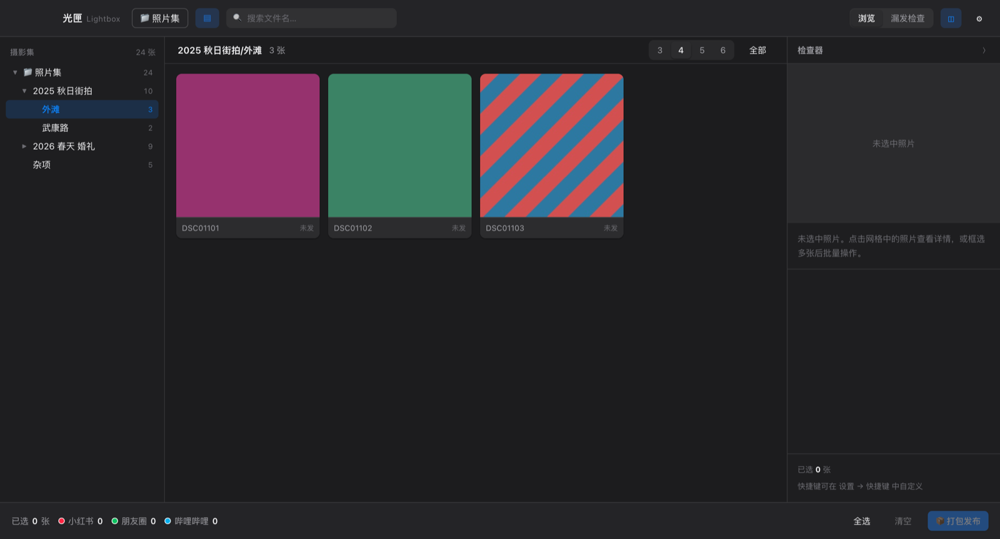

### 2. 选片

| 操作 | 效果 |
|---|---|
| 单击 | 选中一张（替换原选择） |
| `Shift` + 单击 | 从上次点击处连选 |
| `⌘` + 单击 | 加选/减选单张 |
| 在空白处拖动 | 框选（浅蓝选框） |
| `⌘A` | 全选当前视图 |
| `Esc` | 清空选择 |

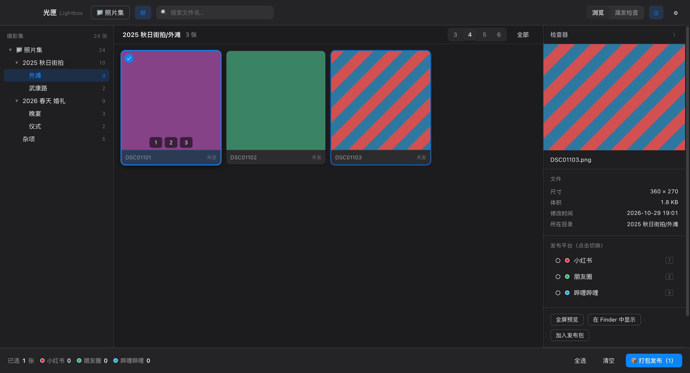

**悬停即出快捷按钮** —— 鼠标移到卡片上，平台数字键浮出，点一下就完成标记：

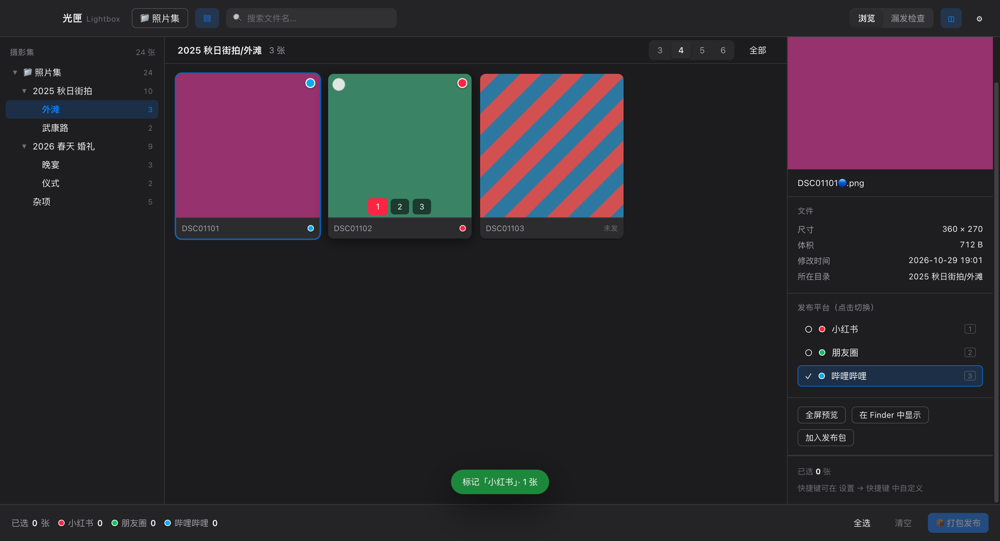

### 3. 平台标记

三种入口，行为一致：

- **键盘**：选中照片后按 `1` / `2` / `3`
- **卡片悬停**：鼠标移到卡片上，点底部的数字按钮
- **检查器**：点「发布平台」下的开关

标记是**切换式**的：已被标记的照片再按一次同一平台键，会取消该平台标记并还原文件名。

> 磁盘上会真实改名。改名后会同步更新界面状态、选中集合与检查器，无需手动刷新。

### 4. 全屏预览

按 `空格` 或检查器里的「全屏预览」按钮进入。

- `←` `→` 切换上下张
- `1` `2` `3` 直接打标（预览条上也能点）
- 点击图片放大 2×，再点还原
- `Esc` 退出

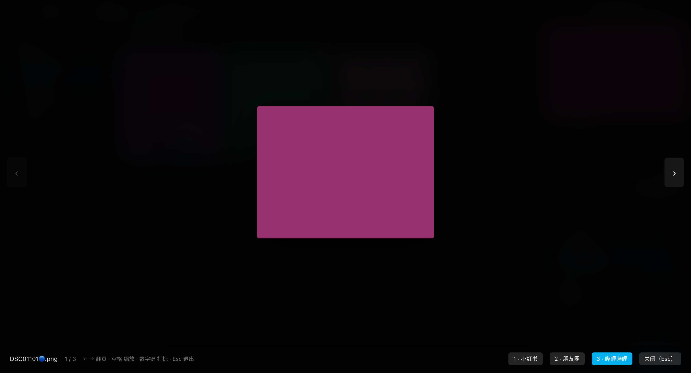

### 5. 打包发布

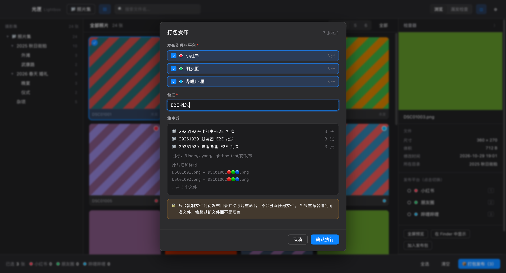

弹窗内实时预演：

- 将生成哪些批次文件夹（含日期、平台、备注）
- 每张原片会改名成什么
- 备注为必填项，未填时「确认执行」按钮禁用

确认后：
1. 按平台逐个创建批次文件夹
2. 把照片复制进去（同名冲突自动追加 `(1)` `(2)`，绝不覆盖）
3. 给原片追加所有本次平台的标记
4. 写入可撤销的操作历史

### 6. 漏发检查

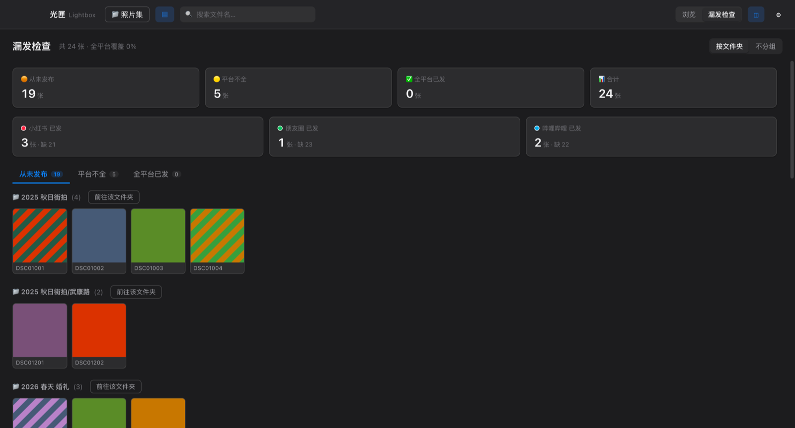

三个分类页签 + 全平台覆盖统计：

| 分类 | 含义 |
|---|---|
| **从未发布** | 一次都没标记过任何平台 |
| **平台不全** | 发过某些平台，但缺其他平台（卡片上虚线色点表示缺失的平台） |
| **全平台已发** | 所有启用的平台都发过了 |

支持「按文件夹」/「不分组」切换。点缩略图可直接跳回浏览视图并定位该照片。

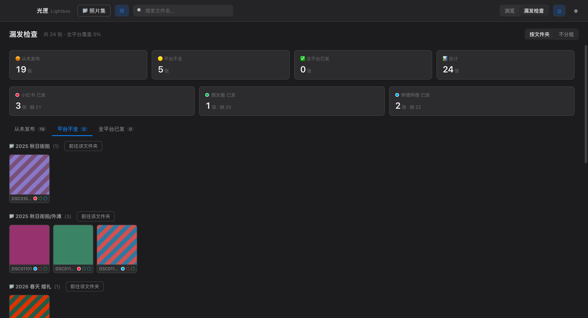

### 7. 设置

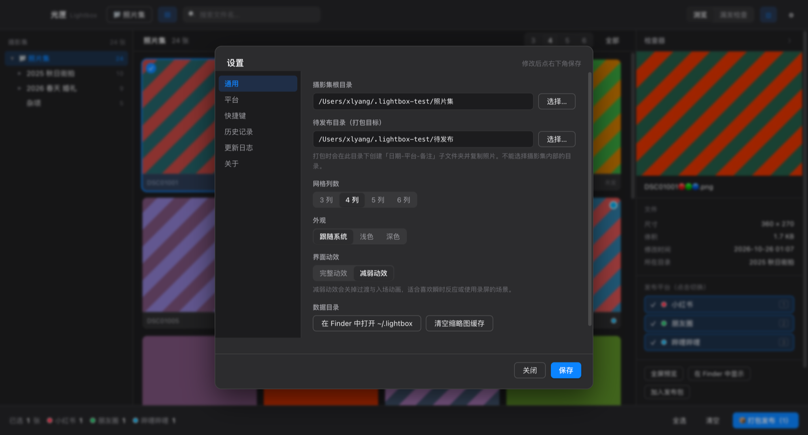

- **通用**：摄影集目录、待发布目录、网格列数（3/4/5/6）、外观（跟随系统/浅色/深色）、
  界面动效（完整/减弱）、缩略图缓存清理
- **平台**：增删平台、改名称、改 emoji、换色点颜色、改快捷数字键、启用/停用，
  保存时校验重名与重复标记
- **快捷键**：全部可自定义，点击后按下任意组合键即录制
- **历史记录**：查看全部操作，支持撤销改名
- **更新日志**：全部版本的变更记录，含本次修复清单
- **关于**：版本、功能说明、运行环境、数据安全承诺

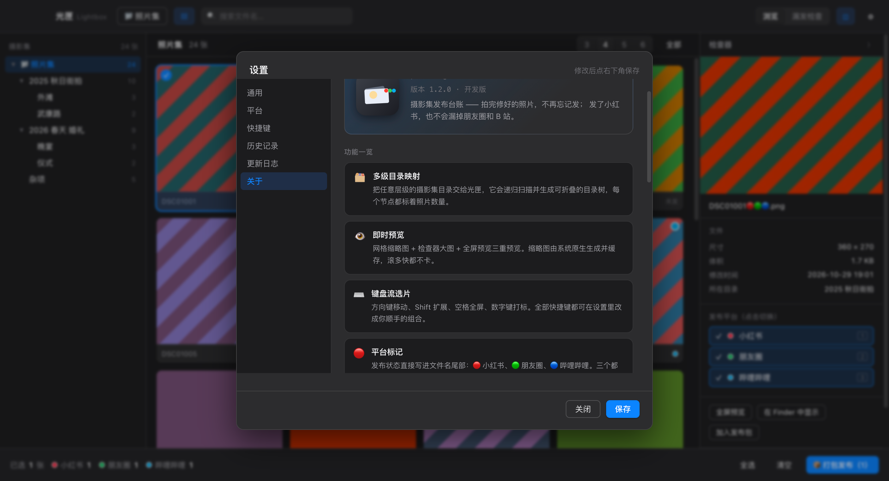

### 8. 更新日志

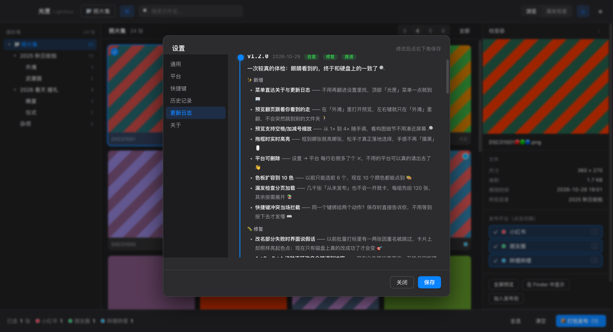

### 9. 撤销

每一次改名和打包都写入 `~/.lightbox/history.jsonl`。在漏发检查页底部或设置的历史记录里点「撤销这次改名」，即可把文件名恢复原状。

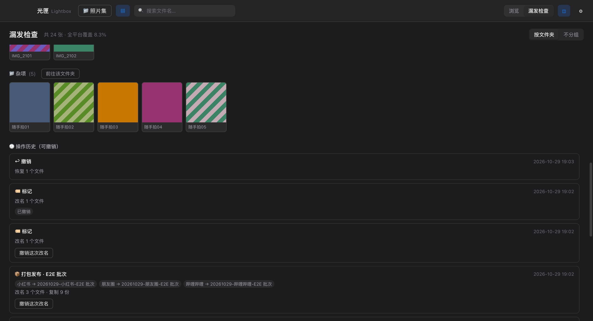

---

## 快捷键

全部可在 **设置 → 快捷键** 中自定义。

| 默认键 | 功能 |
|---|---|
| `→` / `←` | 下一张 / 上一张 |
| `↓` / `↑` | 下四张 / 上四张（按当前列数） |
| `Shift` + 方向键 | 扩展选择 |
| `空格` | 全屏预览 |
| `⌘A` | 全选当前视图 |
| `Esc` | 清空选择 / 退出预览 |
| `Enter` | 选中项加入发布包 |
| `1` `2` `3` | 切换对应平台的标记 |
| `⌘,` | 打开设置 |
| `⌘O` | 打开摄影集 |
| `⌘L` | 打开漏发检查 |

---

## 数据与安全

光匣的核心承诺是**永不删除照片**。

### 硬约束

1. **代码层面无删除调用** —— 整个代码库不含 `fs.unlink`、`fs.rm`、`rimraf`、`rmdir`（测试脚本的临时目录清理除外）。
2. **打包只复制** —— 用 `fs.copyFile`，原片保持原位。
3. **改名先预检** —— 改名前列出目录内容比对目标名，冲突项跳过并记录，不覆盖任何已有文件。
4. **执行期失败自动回滚** —— 若批量改名过程中出现执行级错误，本次已完成的改名会全部反向还原。
5. **待发布目录不能位于摄影集内部** —— 主进程强制校验，避免自我覆盖。
6. **完整审计日志** —— 每次改名、打包、撤销都追加写入 `~/.lightbox/history.jsonl`，永不覆盖。

### 数据存放

| 路径 | 内容 |
|---|---|
| `~/.lightbox/settings.json` | 配置（目录、平台、快捷键、外观） |
| `~/.lightbox/history.jsonl` | 操作历史（追加式） |
| `~/.lightbox/thumbnails/` | 缩略图缓存（按 路径+大小+修改时间 哈希，自动失效） |

删掉 `~/.lightbox` 只会丢失配置与历史，**不会影响任何照片**。

---

## 开发

### 环境

- Node.js ≥ 20
- macOS（使用了 `nativeImage.createThumbnailFromPath` 与 Vibrancy）

### 安装与运行

```bash
npm install
npm run dev        # 构建 + 启动 Electron
```

### 项目结构

```
光匣/
├── electron/
│   ├── main.mjs         # 主进程：窗口、菜单、全部 IPC
│   ├── preload.cjs      # 预加载：安全暴露 API 到渲染进程
│   └── fs-ops.mjs       # 文件系统层：扫描、复制、改名、历史
├── src/
│   ├── lib/
│   │   ├── core.mjs     # 纯函数核心：命名解析、批次计划、覆盖率分析
│   │   └── path.mjs     # 渲染进程用的最小路径工具
│   ├── components/
│   │   ├── Browser.jsx  # 目录树、照片网格、检查器
│   │   ├── Dialogs.jsx  # 打包弹窗、全屏预览、Toast
│   │   ├── Checker.jsx  # 漏发检查
│   │   └── Settings.jsx # 设置
│   ├── App.jsx          # 应用外壳与全部状态
│   ├── main.jsx
│   └── styles.css       # 设计系统（Apple 风格变量）
├── scripts/
│   ├── make-fixtures.cjs  # 生成测试照片集
│   ├── make-icon.cjs      # 纯代码绘制 app 图标
│   ├── e2e.cjs            # E2E 驱动（CDP）
│   ├── e2e-scenario.cjs   # E2E 场景脚本
│   └── after-sign.cjs     # adhoc 深签钩子
└── tests/
    ├── core.test.mjs      # 纯逻辑单元测试
    └── fs-ops.test.mjs    # 真实文件系统集成测试
```

### 架构要点

- **渲染进程无 Node 权限**（`contextIsolation: true`, `nodeIntegration: false`），全部文件操作走 IPC。
- **核心逻辑集中在 `core.mjs`**，不依赖 Electron，纯函数、可单元测试。
- **文件名是唯一状态源** —— 不做额外数据库，重启后重新扫描即可还原全部状态。

### 打包

```bash
npm run dist     # 产出 release/光匣-<version>-arm64.dmg
```

> ⚠️ 必须用 `npm run dist`，它带 `--config.afterSign=scripts/after-sign.cjs`。
> 直接调用 electron-builder 只会得到 linker-signed adhoc 签名，应用启动即静默挂起。

验证产物：

```bash
codesign -dv release/mac-arm64/光匣.app | grep flags
# 应出现 flags=0x2(adhoc)，若是 0x20002(adhoc,linker-signed) 说明漏了钩子
```

---

## 测试

### 自动化测试

```bash
npm test         # 56 个单元 + 集成测试
npm run e2e      # 62 个界面端到端步骤（自动截图到 screenshots/）
```

E2E 会启动真实 Electron，通过 Chrome DevTools Protocol 派发**真实鼠标与键盘事件**（不是 JS 的 `el.click()`，后者在 React 受控组件上不可靠），逐步验证并在每一步截图。

完整测试记录见 [TEST-REPORT.md](TEST-REPORT.md)。

---

## 已知限制

- **不支持 RAW 预览** —— 只处理 `jpg / jpeg / png / heic / heif / webp / gif / bmp / tif / tiff / avif`。RAW（ARW/CR3/NEF）不显示，需要先导出 JPEG。
- **仅 Apple Silicon** —— 打包的是 arm64 版本。Intel Mac 需自行 `--x64` 重新构建。
- **未做代码签名公证** —— adhoc 签名，首次打开需要在「系统设置 → 隐私与安全性」里点「仍要打开」。
- **删除平台后的历史标记** —— 老文件上的孤儿标记会被识别并在下次改名时清除，但已写入历史的旧记录不会改写。
- **平台清单是记账用的** —— 光匣不调用任何平台 API，实际发布仍需你手动完成。
- **缩略图为正方形裁切** —— 网格按 1:1 显示，全屏预览才看完整画幅。

---

## 许可

MIT
